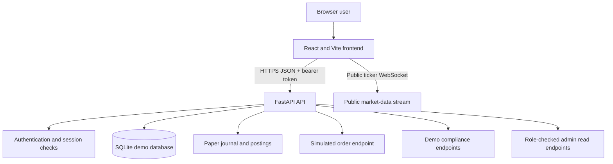

# ZenCrypto architecture

## System context

ZenCrypto is currently a paper-trading demonstration. The browser UI and FastAPI API are separate processes. The API is the authority for demo user accounts, simulated balances, order history and sandbox ledger postings. The browser's market ticker is indicative public market data and is not an executable quote.

## Current request flows

### Registration and login
1. User submits an email and password.
2. API validates basic email shape and password length.
3. Password is stored as a PBKDF2-HMAC-SHA256 hash with a random salt.
4. Login creates a server-side session row and signs its opaque session identifier.
5. Authenticated routes validate signature, expiry, revocation and session existence.

This is a prototype authentication flow. It does not yet implement MFA/passkeys, email verification, abuse throttling, a production cookie/CSRF strategy or a full account recovery process.

### Paper order
1. Authenticated user submits asset symbol, side, quote amount, reference price and an idempotency key.
2. API validates numeric inputs using Decimal and converts USD to cents and asset quantities to 8 decimal places.
3. A SQLite write transaction serializes the demo operation.
4. The API checks idempotency and available simulated balances.
5. The API posts balanced debit/credit entries to the paper journal, inserts the order and stores the idempotent response.
6. The API commits and returns a simulated fill.

The submitted reference price is user-provided demo input. There is no order book, external execution, price-time priority, market surveillance, live settlement or customer asset movement.

### Paper faucet
1. Authenticated user submits a positive USD amount and idempotency key.
2. The API checks prior use and a lifetime $1,000 virtual-funds cap.
3. A balanced demo journal credits the user's paper USD account against a paper-faucet system account.
4. The operation is audited and committed.

### Compliance disclosure
The compliance page reports what has and has not been verified. The backend's KYC route records a demonstration declaration only; it is not identity verification. Real deposits and withdrawals are explicitly blocked. No licence or approval should be inferred from this software.

## Data model

- `users`: demo identity, password hash, role and demo KYC status.
- `sessions`: server-side session expiry and revocation.
- `accounts`: one demo account per user and currency.
- `journal`: transaction header for each simulated ledger operation.
- `postings`: signed integer minor-unit entries attached to a journal.
- `orders`: simulated order and fill record.
- `sandbox_operations`: idempotency key and cached operation response.
- `audit`: demo operational events.
- `kyc`: demonstration declaration; do not use to collect real identity documents.
- `compliance_cases`: demo review cases.

## Trust boundaries and invariants

- Browser data is untrusted. The API validates every submitted value.
- Every user-specific query is scoped to the authenticated user ID.
- Administrative reads require a server-side role check; UI visibility does not grant privilege.
- Every paper journal must balance independently for each currency.
- Journal and posting rows are protected against ordinary update/delete operations by SQLite triggers.
- Paper balances and real assets are separate concepts. No real asset is represented by a paper ledger posting.
- Deposits and withdrawals return HTTP 403. Live-money trading is not implemented.
- Idempotency keys prevent duplicate demo operations and reject reuse with different request parameters.

## Production architecture is not implemented

A future production design would require a separately reviewed architecture for PostgreSQL migrations and transaction isolation, a reserved/available balance model, a real order book and matching engine, custody/wallet integration, banking/payment rails, verified KYC/AML and sanctions controls, monitoring, reconciliation, key management, security operations and jurisdiction-specific authorization. Those systems must not be activated by a UI flag or by changing a string in configuration.
